# Plan: Phân hệ "Slide cưới" (video trình chiếu ảnh cưới)

> **Hướng hiện tại (chốt 2026-11-05):** chưa làm trình tạo slide từ ảnh của khách. Thay vào đó
> là **mẫu slide dựng sẵn** (phong cách do mình thiết kế) chạy bằng **dữ liệu của thiệp thật**:
> khách chọn mẫu → tích "Lấy dữ liệu từ thiệp của bạn" (mọi thiệp của tài khoản, KHÔNG xét
> thanh toán) → xem trước / trình chiếu toàn màn. Không tích thì slide chạy dữ liệu mẫu.
> Cái bán sau này là **mẫu slide**: mẫu đẹp thu phí, mẫu miễn phí là mẫu đơn giản.
>
> Slide là màn **chiếu lên sân khấu tiệc cưới**, KHÔNG phải bản sao thiệp: từ thiệp chỉ lấy
> ảnh cưới, họ tên, ngày cưới, chuyện tình — **không hiện tên cha mẹ, không hiện địa chỉ** (khách đã có mặt ở tiệc, slide chiếu trên màn LED) ở mẫu nào; lời văn là của mẫu (lời chú rể / cô dâu
> gửi quan khách, gửi cha mẹ, lời cảm ơn). Bố cục: **ảnh một bên, chữ một bên**.
> Xưng hô trong lời văn: cô dâu, chú rể nói với quan khách và cha mẹ thì xưng **"con"**; chú rể
> nói với cô dâu là **"anh"**, cô dâu nói với chú rể là **"em"**. **Không chèn họ tên vào lời văn**
> — tên chỉ đứng riêng ở cảnh mở đầu.
> Mẫu đầu tiên: `templates/romantic-blush/` ("Mãi mãi về sau") — 16:9 hồng pastel khối màu phẳng
> (dải hồng dọc + ảnh chữ nhật đè mép dải, dải da đào kèm lát ảnh nhỏ ở mép kia, cụm chấm tròn,
> tiêu đề viết hoa chữ không chân), mọi khối bay từ ngoài vào; mỗi cảnh hai ô ảnh (`<id>` và
> `<id>.p1`). Mẫu thứ hai: `templates/mai-ben-nhau/` ("Mãi Bên Nhau") — bố
> cục tạp chí (nền hồng xám, mảng nâu be lệch sau ảnh, tiêu đề tiếng Anh viết hoa dãn rộng,
> chữ dọc sát mép), mỗi cảnh nhiều ảnh bay từ ngoài khung vào. **Thiệp ít ảnh hơn số khung thì
> ảnh LẶP VÒNG cho đủ** — không bớt cảnh, không để khung trống. Mẫu này theo LỜI CÔ DÂU: sau Mở đầu + Đôi
> uyên ương là lời cô dâu (~1 phút, gửi quan khách · bố mẹ · anh) chạy chữ kiểu máy chữ ở nhịp
> nói để cô dâu thu âm theo ở tab Âm thanh; phần dài quá khung tự chia thêm cảnh nối tiếp (không cố
> định 3 cảnh). Chú rể chỉ có "My groom" ngắn, không có cảnh "My bride". KHÔNG hiện tên bố mẹ.
>
> **Vẽ bằng canvas + xuất video bằng WebCodecs (chốt 2026-11-06)**, chạy trọn trên máy khách:
> xem trước, trình chiếu và xuất video dùng CÙNG một bộ vẽ nên video ra y hệt bản xem.
> Đo trên máy dev (Chrome): slide 2 phút 17 giây xuất 1080p mất ~24 giây; 4K nhanh hơn
> thời lượng thật khoảng 1,7 lần. Phần dưới (§1–§6) là kế hoạch CŨ.

> **Phân hệ này KHÔNG GHI gì lên server/DB** — chỉ đọc thiệp của tài khoản. Chữ sửa nằm ở
> localStorage, ảnh khách tự tải lên nằm ở IndexedDB của máy; không upload Storage, không
> Edge Function ghi, không changelog. Thêm tính năng mới cũng giữ nguyên luật này.

### Cấu trúc hiện tại

```
slide-cuoi/
  index.html, index.js     Sân khấu (khung xem iframe trên nền hồng phấn + Trình chiếu / Xuất
                           video, GHIM khi cuộn: từ lg là cột trái, dưới lg ghim đầu màn) +
                           bảng chỉnh ba tab: Cảnh (mỗi dòng một cảnh — ảnh nhỏ, tên, mốc giờ;
                           bấm là chiếu cảnh đó + mở phần đổi ảnh/lấy nét và sửa chữ) ·
                           Thiệp (dùng thiệp của tài khoản) · Mẫu
  templates.js             Danh mục mẫu slide (CX_SLIDE_TEMPLATES)
  engine/slide-engine.js   Bộ vẽ canvas: build(tpl, wedding) → dự án; frame(ctx, P, t) vẽ khung
                           tại t (thuần theo t). Phần tử: rect · grad · frame · line · image
                           (cover theo điểm lấy nét, Ken Burns) · text (tự xuống dòng; caps ·
                           ls dãn chữ · align · shadow · rot xoay) · sparkle (đốm sáng) · group;
                           hiệu ứng fade · up · left · right · spread · wipe · type (đánh chữ
                           cho LỜI NÓI, mẫu tự xếp các đoạn gõ nối đuôi) · fly (bay từ ngoài
                           khung vào, phanh êm; `rot` xoay / `back` nảy chỉ khi mẫu khai) · zoom · flip · reveal (mở từ một mép) ·
                           track (chữ dãn rồi khép) · letters · lines; chuyển cảnh `tr` của
                           cảnh/mẫu: fade · slide · slide-up · zoom · split; `CX_SLIDE.fx.sparkle`
                           = lớp đốm sáng phủ suốt slide. Ảnh to hơn khung thu nhỏ MỘT lần lúc
                           dựng (đủ nét cho 4K)
  engine/slide-export.js   Vẽ từng khung 30 hình/giây ở 1920×1080 / 3840×2160 → VideoEncoder
                           H.264 → vendor/mp4-muxer.js → Blob MP4. Nhạc FILE thì ghép AAC
  vendor/mp4-muxer.js      mp4-muxer 5.2.2 tự host (MIT) — đừng sửa tay
  runtime/slide-runtime.*  Bộ phát trong iframe: đồng hồ riêng (tạm dừng = dừng đồng hồ), nhảy
                           cảnh, thanh điều khiển, nhạc file + giọng đọc, toàn màn hình, xuất video
  templates/<id>/          Một mẫu = index.html (nạp engine + runtime) + index.js (CX_SLIDE:
                           khổ, font, scenes(w, L) trả cảnh dưới dạng dữ liệu) + thumb.jpg
```

- Dữ liệu: trang cha lấy `listMyWeddings` (cả nháp lẫn đã xuất bản) rồi `getWeddingById`
  (chỉ chủ thiệp) và gửi hàng thiệp vào iframe bằng `postMessage` — mẫu KHÔNG tự gọi API,
  nên không cần đăng nhập trong iframe.
- Dữ liệu lấy CHUNG của thiệp (lễ thành hôn), không tách nhà trai / nhà gái.
- Thiệp được chia sẻ quyền quản lý (thành viên) không hiện: `getWeddingById` chỉ trả cho chủ.
- Sửa chữ: **mọi chữ hiện trên slide phải sửa được** ở mục "Chữ trong slide" — mỗi khối chữ
  mẫu khai có khoá `<id cảnh>.<vị trí trong mảng khai>` (cột con thêm `.<cột>.<dòng>`), gán ở
  `_scene` của mẫu. Trang cha lưu `{khoá: chữ}` ở `localStorage.cx_slide_texts` theo
  `<mẫu>|<id thiệp hoặc demo>` — **chỉ localStorage, cố ý không lưu lên server**. Sửa thành
  rỗng là bỏ khối.
- Ảnh từng cảnh: cảnh khai các Ô ẢNH, mỗi ô `{key, def, w, h}` — `photos: [...]` (nhiều ô, khoá
  `<id cảnh>.p<n>` ở mai-ben-nhau) hoặc `photo` (một ô, khoá = id cảnh ở romantic-blush); mặc
  định là ảnh thiệp, hoặc ảnh mẫu khi chưa chọn thiệp. Cảnh một ô hiện ảnh đúng khổ + nút, cảnh
  nhiều ô hiện lưới ô vuông. Khách bấm ô để thay bằng ảnh trong máy: nén (cạnh dài ≤ 2560px) rồi
  cất BYTE vào IndexedDB `cx_slide/photos` theo `<mẫu>|<id thiệp hoặc demo>|<khoá ô>` — không lên
  server. Trang cha gửi `{khoá ô: {id, blob, focal}}`, khung đổi thành blob URL và đưa vào
  `L.photos`; mẫu đè ảnh của ô bằng `L.photos[khoá ô]` = `{src, focal}`. Chọn ảnh xong là mở
  bảng lấy nét (`openFocalPointPicker`, `core/utils.js` nạp lúc cần) xem trước đúng khổ khung ô
  (`w/h`); huỷ bảng = bỏ ảnh vừa chọn. Ô đã thay có nút "Lấy nét" để chỉnh lại.
- Thời lượng: thẻ "Thời lượng cả slide" (hệ số 0,5×–2× nhân thời lượng mẫu) + thanh "Thời gian
  cảnh" trong từng cảnh (giây, đè hệ số). Lưu `localStorage.cx_slide_timing` theo
  `<mẫu>|<id thiệp hoặc demo>` = `{scale, scenes: {id cảnh: giây}}` — chỉ trên máy. Engine kẹp
  mỗi cảnh trong [min, max]: min = lúc mọi hiệu ứng của cảnh chạy xong + 1 giây (`_end`), max
  30 giây; đổi thời lượng chỉ `retime` (đặt lại mốc), không dựng lại dự án. Cảnh phải có `id`
  ổn định (mẫu đặt = id cảnh), thiếu thì engine lấy vị trí — chèn cảnh là lệch thời lượng đã chỉnh.
- Dòng thời gian kiểu bàn dựng phim (`timeline.js` vẽ + thao tác, `voice.js` giữ dữ liệu + thêm
  file + thu âm). Máy tính: dock trải ngang đáy trang; màn nhỏ: trong tab Âm thanh. Hàng từ trên
  xuống: thước giây (kéo = tua) · track Cảnh · track Nhạc nền · các track giọng đọc · hàng "Track
  mới" (dấu + / bấm làn = thêm file vào track mới, micro = thu vào track mới, thả clip vào = tạo
  track mới).
- Track giọng đọc: tối đa 10 track, mỗi track NHIỀU clip, trên một track clip không chồng nhau
  (thả chồng → tự dời tới chỗ trống gần nhất, hết chỗ thì xuống track mới). Mỗi clip trỏ tới một
  NGUỒN (`src`): tách / nhân bản / dán tạo clip mới cùng nguồn, không nhân đôi byte — tối đa 10
  file (≤ 50 MB/file) và 60 clip. Đầu track: M (tắt tiếng) · S (solo — chỉ nghe các track solo, kể
  cả Nhạc nền) · khoá (không kéo / sửa được) · micro (thu một clip mới từ đầu phát) · ⋯ (âm lượng
  track, đổi tên, thêm file, đổi thứ tự, xoá track). Track Nhạc nền cùng bộ nút đó (mức + tắt /
  solo đi vào `cut.vol` gửi khung).
- Clip: bấm = chọn (Shift / Ctrl: thêm bớt, kéo vùng trống = khung chọn); kéo thân = dời cả cụm,
  kể cả sang track khác (Alt = kéo ra bản sao); kéo mép = cắt (không lấn sang clip kề); kéo ô
  vuông góc trên = to dần / nhỏ dần; dây vàng = đường âm lượng (kéo dây = nâng hạ cả đường, Ctrl +
  bấm = thêm điểm, bấm đúp điểm = xoá) — điểm tính theo giây TRONG FILE nên cắt mép không làm lệch.
  Thanh nổi của clip (`#sc-vo-act`): To dần · Nhỏ dần · Tách · Nhân bản · Thu lại · Thay thế · Xoá.
  Hút vào đầu cảnh / đầu phát / mép clip khác (bật tắt bằng S).
- Track Cảnh: bấm = nhảy tới cảnh + thanh (Sửa · Chuyển cảnh · Xoá); kéo thân = đổi thứ tự
  (`timing.order`), kéo mép phải = thời lượng (`timing.scenes`, kẹp [min, max]); dấu thoi ở chỗ
  nối = kiểu chuyển vào cảnh sau (`timing.tr`, thêm "cut" = cắt thẳng). Cả ba nằm trong `timing`
  nên preview, trình chiếu và video xuất đi chung `retime` của engine.
- Lịch sử hoàn tác (Ctrl+Z / Ctrl+Shift+Z, 100 bước, trong phiên): mỗi bước giữ trạng thái trước /
  sau của track + clip (kèm mức giảm nhạc), bài nhạc + đoạn cắt, `timing`, chữ sửa và ảnh từng ô —
  hoàn tác chỉ trả lại miền bước đó đổi, `timing` / chữ / ảnh trả từng khoá. Kéo thanh hay gõ một ô
  chữ là MỘT bước (`_scTlHoldOpen`). Byte ảnh / file nhạc đã bỏ giữ trong bộ nhớ (`_scPhBank`,
  `_scMuBank`) để còn trả lại. Đổi mẫu / thiệp là xoá trắng lịch sử. Phím tắt đầy đủ ở `#sc-tl-keys`.
- Lưu: byte file ở IndexedDB kho `voice` (BYTE, không Blob, kèm đỉnh sóng âm) theo
  `<mẫu>|<id thiệp hoặc demo>|<src>`; track + clip + mức "nhạc nền khi có giọng" ở
  `localStorage.cx_slide_voice` — không lên server. Dữ liệu bản cũ (mỗi file một lớp) đọc thành mỗi
  clip một track. Byte không còn clip nào trỏ tới chỉ dọn lúc nạp lại (trong phiên còn để hoàn tác).
  Khung phát clip khớp đồng hồ slide (`Voice` ở runtime, `envGain` cho đường âm lượng), hạ nhạc khi
  có giọng; bộ xuất trộn nhạc + giọng bằng OfflineAudioContext (`_mix`, cùng phép tính). Vị trí clip
  là giây TUYỆT ĐỐI của slide — đổi thời lượng / thứ tự cảnh thì clip không chạy theo.
- Ảnh thiệp đi qua worker ảnh / Storage: lượt tải crossOrigin hỏng thì engine tải lại kèm
  `?cx-cors=1` — bản trong cache trình duyệt có thể là bản KHÔNG có header CORS (thẻ ``
  thường, worker ảnh bản cũ cache 30 ngày) và canvas không nhận nó.
- Tin nhắn iframe ↔ trang cha: `cx-slide-ready` · `cx-slide-data` (thiệp + chữ đã sửa + ảnh
  khách + thời lượng) · `cx-slide-texts` (chữ đã sửa, dựng lại tại cảnh đang mở) ·
  `cx-slide-timing` (thời lượng, chỉ đặt lại mốc) · `cx-slide-voice` (giọng đọc) · `cx-slide-time`
  (khung báo vị trí đầu phát ~10 lần/giây) · `cx-slide-seek` / `cx-slide-play` (dòng thời gian tua,
  phát/dừng — bấm phát từ trang cha cũng bật tiếng) · `cx-slide-photos` (ảnh
  khách, dựng lại tại cảnh vừa đổi) · `cx-slide-edit` (bấm thẳng lên slide: `{index, kind:
  "text"|"photo", key}` → trang cha mở cảnh, đặt con trỏ vào ô chữ / khối ảnh) · `cx-slide-state` (danh sách
  cảnh kèm chữ + cảnh đang chiếu + loại nhạc) · `cx-slide-go` (`pause` = dừng ở cảnh đó,
  chữ đã hiện đủ) · `cx-slide-full(-state)` · `cx-slide-caps`
  (máy mã hoá được 1080p/4K/bản xem thử không) · `cx-slide-export` (`height`: 1080 · 2160 · `"demo"`) / `-cancel` / `-state` (tiến độ, Blob).
- Sửa ngay trên slide: rê chuột lên chữ/ảnh thì runtime vẽ khung nét đứt + nhãn lên canvas
  XEM TRƯỚC (không qua engine nên video xuất không dính), lần nạp đầu viền mọi vùng nhấp nháy
  ~2,6 giây, chip "Bấm vào chữ hoặc ảnh để sửa" hiện cùng thanh điều khiển. Vùng sửa = phần tử
  chữ có `key` (engine chép từ khối) + ảnh có `edit: <khoá ô>` — mẫu mới phải giữ hai dấu
  này. Tắt hẳn khi trình chiếu toàn màn hoặc đang xuất video.
- Ảnh phải tải với `crossOrigin="anonymous"`, thiếu là canvas bị "nhiễm" và VideoFrame từ chối
  xuất. Supabase Storage và worker proxy ảnh đều trả `Access-Control-Allow-Origin: *`.
- Font phải tải xong trước khi đo chữ (`CX_SLIDE.fonts`) — canvas không tự đợi font.
- **Không dùng nhạc của thiệp** (thường là YouTube — không ghép được vào video vì không lấy được
  luồng tiếng, lại trái điều khoản): khách không chọn nhạc ở tab Âm thanh thì slide KHÔNG có nhạc,
  trang không còn khối nào nhắc YouTube. Nhạc file thì ghép vào video, lặp + mờ vào/ra.
- Nhạc nền (phần dưới tab **Âm thanh**): file từ máy (MP3/M4A/WAV ≤ 30 MB, cất BYTE ở
  IndexedDB kho `music`, khoá = id thiệp hoặc `demo` — không theo mẫu) · bài trong thư viện
  `CONFIG.slideMusic.library` (`{tracks:[{id, title, artist, file, credit}]}`; `file` tính theo
  URL của file danh mục, `credit` hiện dưới danh sách khi bài cần ghi công). Kho chưa dựng /
  rỗng / lỗi mạng / treo quá 6 giây → "Thư viện nhạc hiện đang chưa có". Kho là dịch vụ NGOÀI
  nên **không bao giờ chặn slide**: dữ liệu gửi sang khung không chờ kho; bài thư viện đã chọn
  chỉ được áp khi kho trả lời, trước đó (hoặc kho chết) slide chạy không nhạc. Gửi sang khung: `{id, blob}` · `{url}` ·
  null qua `cx-slide-data` / `cx-slide-music`.
- **Kho nhạc thư viện** = Worker CHỈ phục vụ file tĩnh `cuoixinh-media` ở tài khoản Cloudflare phụ (`cuoixinh-media.cx-music.workers.dev`)
  (thư mục `cloudflare-media/`, `npm run deploy:media`) — không tính vào 10 GB miễn phí của R2,
  file nhạc không vào git (`public/songs/` bị .gitignore, wrangler đọc file trên máy). Thêm bài:
  chép file vào `cloudflare-media/public/songs/`, thêm mục vào `public/library.json`, deploy.
  Chỉ đưa bài có giấy phép dùng thương mại (CC0, hoặc CC BY kèm `credit`). Mọi file có CORS
  (`public/_headers`); đổi tên miền thì đổi cả `CONFIG.slideMusic` lẫn `connect-src` của
  `_headers` site chính (bộ xuất `fetch` file nhạc). Đừng chạy wrangler trần ở gốc repo cho
  kho này: nó đọc `wrangler.jsonc` của site chính.
- Mã tiếng khi xuất: AAC nếu máy có bộ mã, không thì Opus (Chromium mã nguồn mở, Firefox, Chrome
  Linux không có AAC). Khung báo `audio` trong `cx-slide-caps` và lý do video không tiếng
  (`mute`: yt · codec · decode) khi xong, trang ghi đúng lý do. File nhạc khách tải lên đưa
  thẳng Blob cho bộ xuất: CSP chặn `fetch` URL `blob:`.
- **Bản TikTok** (lựa chọn "TikTok" trong ô Xuất video, mặc định): video DỌC 2K 1440×2560
  ~12 Mbps (H.264 level 5.0+), slide vẽ riêng rồi đặt vào ô màn chiếu của ảnh hội trường
  `slide-cuoi/assets/hall.jpg`, `cuoixinh.com` ở đáy — để đăng TikTok/mạng xã hội. Ô màn chiếu khai MỘT chỗ (`HALL` ở
  `engine/slide-export.js`); nút "Màn chiếu" dưới slide dựng đúng bố cục đó bằng CSS
  (`.sc-stage.is-hall`) — đổi ảnh hội trường thì sửa cả hai bộ số. 1080p/4K hiện CHƯA khoá theo
  thanh toán (xem dòng dưới).
- Bán mẫu (chưa làm): khoá theo MẪU slide chứ không theo thiệp. Lúc làm thì phải kiểm ở
  server — chặn ở client là ai cũng mở thẳng `templates/<id>/` được.

### Việc tiếp theo

- Thêm mẫu slide (bộ vẽ nhận `CX_SLIDE.w/h` bất kỳ, khung xem theo `ratio` ở templates.js).
- Thử xuất trên Safari (macOS/iOS) và điện thoại Android tầm trung; điện thoại 4K dễ hết bộ
  nhớ — nếu vậy chỉ mở 1080p cho điện thoại.
- File 4K của slide dài nằm trọn trong RAM (~16 Mbps → slide 2 phút ~270 MB). Slide dài hơn
  nhiều thì chuyển sang ghi thẳng ra đĩa (StreamTarget + File System Access).

---

**Mục đích (kế hoạch cũ): công cụ MIỄN PHÍ để kéo người truy cập vào trang**, KHÔNG gắn với thiệp cưới.
Khách chọn ảnh → chọn mẫu slide + nhạc + chữ → xem trước → **xuất video** để đăng mạng xã
hội, gửi Zalo, chiếu màn LED ở tiệc cưới. Không cần đăng nhập, không trả tiền.

Hệ quả thiết kế — giữ cho phân hệ này **chạy trọn ở trình duyệt**:

- Không bảng DB, không Edge Function, không changelog, không upload ảnh lên Storage → không
  tốn chi phí theo số người dùng, không có dữ liệu cá nhân của khách nằm trên server.
- Không đụng tới luồng thiệp: không lấy ảnh từ thiệp, không gắn vào thiệp, không thanh toán,
  không đọc `CXAuth` (đăng nhập hay chưa đều dùng như nhau).
- Giá trị thu về là **lượt truy cập**: trang dễ lên Google, và sau khi xuất xong có lời mời
  sang làm thiệp. Video xuất ra **sạch** — không màn kết, không logo (đã chốt).

---

## 1. Định dạng xuất đề xuất

| #   | Định dạng                          | Dùng cho                                                  | Cách làm                                      | Giai đoạn |
| --- | ---------------------------------- | --------------------------------------------------------- | --------------------------------------------- | --------- |
| 1   | **MP4** (H.264 + AAC), 1080p 30fps | Mọi nơi: Facebook, Zalo, TikTok, YouTube, USB cắm TV      | WebCodecs `VideoEncoder` + muxer MP4          | P1        |
| 2   | **WebM** (VP9 + Opus)              | Dự phòng khi máy không mã hoá được H.264 (Firefox/Linux…) | Cùng đường WebCodecs, đổi codec + muxer       | P1        |
| 3   | **GIF / WebP động** (≤ 10s, 480px) | Teaser gửi chat Zalo/Messenger, ảnh động story            | Lấy mẫu khung từ cùng engine + `gifenc`       | P2        |
| 4   | **Bộ ảnh JPG từng slide** (.zip)   | In ảnh, khung ảnh điện tử, đăng album                     | `canvas.toBlob` từng cảnh + nén zip           | P2        |
| 5   | **MP4 4K / 60fps**                 | Màn LED lớn ở hội trường                                  | Như (1), chỉ khi `isConfigSupported` cho phép | P2        |

**Ba khổ khung** cho (1)(2)(3): **9:16** (1080×1920 — Reels/TikTok/Zalo story, mặc định trên
điện thoại), **16:9** (1920×1080 — màn LED, TV, YouTube), **1:1** (1080×1080 — bảng tin
Facebook). Cùng một dự án xuất được cả ba: mẫu slide khai bố cục theo tỉ lệ, ảnh tự cắt theo
**điểm nhìn** (dùng lại `openFocalPointPicker()` ở `core/utils.js`).

Trên điện thoại, xuất xong có nút **Chia sẻ** (`navigator.share` kèm file) để đẩy thẳng sang
Zalo/Facebook/TikTok, khỏi phải tìm file trong máy.

Không đề xuất: **link xem online** (phải lưu ảnh khách lên server → tốn kho + dữ liệu cá nhân,
trái mục đích công cụ miễn phí), **MOV/AVI** (không thêm gì so với MP4), **PowerPoint** (mất
hiệu ứng/nhạc), **ffmpeg.wasm** (xem §3.3).

---

## 2. Luồng người dùng

```mermaid
flowchart LR
  A[Trang chủ: menu 'Slide cưới'] --> B["/slide-cuoi/ — giới thiệu + trình tạo"]
  B --> C[1. Chọn ảnh]
  C --> D[2. Sắp xếp + điểm nhìn]
  D --> E[3. Chọn mẫu slide]
  E --> F[4. Nhạc]
  F --> G[5. Chữ: tên, ngày, lời cảm ơn]
  G --> H[Xem trước]
  H --> I[Xuất MP4 / WebM]
  I --> J[Tải về · Chia sẻ]
  J --> K[Lời mời: xem mẫu thiệp]
```



1. **Chọn ảnh** — từ máy (nhiều ảnh, kéo thả). Gợi ý 15–40 ảnh. Ảnh **không rời máy khách**
   — nói rõ điều này trên trang, đó là một điểm cộng để khách yên tâm.
2. **Sắp xếp** — kéo đổi thứ tự, nút "Xếp theo ngày chụp" (EXIF), đặt điểm nhìn từng ảnh.
3. **Mẫu slide** — xem trước chạy thật trong khung điện thoại.
4. **Nhạc** — thư viện nhạc miễn phí bản quyền tự host + tải mp3 từ máy; cắt đoạn bắt đầu,
   fade in/out; độ dài video tự khớp độ dài đoạn nhạc (hoặc ngược lại).
5. **Chữ** — tên cô dâu chú rể, ngày cưới, câu mở đầu/kết thúc (khách tự gõ).
6. **Xuất** — chọn khổ + định dạng → thanh tiến độ → tải về / chia sẻ → khối mời làm thiệp.

Trang `/slide-cuoi/` vừa là trang giới thiệu (cho SEO: "làm video slide ảnh cưới miễn phí")
vừa chứa trình tạo — khách vào là dùng được ngay, không qua thêm trang nào.

---

## 3. Kiến trúc kỹ thuật

### 3.1 Một engine dựng hình duy nhất

Xem trước và bộ xuất video gọi **CÙNG MỘT hàm** `renderFrame(ctx, project, t)` — vẽ khung tại
thời điểm `t` lên canvas, **thuần theo thời gian** (không dựa `requestAnimationFrame`, không
trạng thái ẩn). Nhờ vậy xuất video là lặp `t = 0, 1/30, 2/30…` chính xác từng khung, không phụ
thuộc máy nhanh hay chậm, và video ra y hệt bản xem trước.

```
slide-cuoi/
  index.html            Trang giới thiệu + trình tạo
  js/slide-model.js     Dự án → timeline (cảnh, thời lượng, chuyển cảnh); validate
  js/slide-engine.js    renderFrame(ctx, project, t) — Canvas 2D: Ken Burns, chuyển cảnh, chữ
  js/slide-assets.js    Ảnh → ImageBitmap đã thu nhỏ về khổ xuất; nạp font (document.fonts.load)
  js/slide-audio.js     Giải mã nhạc, cắt + fade bằng OfflineAudioContext → PCM
  js/slide-export.js    Vòng lặp mã hoá: VideoEncoder/AudioEncoder → muxer → Blob
  js/slide-player.js    Phát xem trước (rAF gọi renderFrame)
  js/slide-ui.js        Các bước, kéo thả, thanh tiến độ
  templates/<tên>.js    Bản khai mẫu slide (chỉ khai báo)
```

Để trọn trong `slide-cuoi/` (không rải vào `core/`) vì không trang nào khác dùng — đúng tinh
thần "không gắn với thiệp". Thư mục đã khai ở `INCLUDE` nên file mới bên trong tự ra web.

**Mẫu slide là bản khai**, không phải mã vẽ riêng: danh sách cảnh (1 ảnh / 2 ảnh ghép / ảnh +
chữ), chuyển cảnh (`fade`, `slide`, `zoom`, `wipe`…), kiểu chữ (font tự host ở
`styles/_fonts.css`), bảng màu. Engine lặp bố cục của mẫu cho đủ số ảnh. Chuyển cảnh nằm DUY
NHẤT trong engine (thêm hiệu ứng mới = thêm một hàm ở đó), mẫu chỉ chọn tên. Canvas 2D đủ cho
P1; hiệu ứng nặng (blur động, lật trang 3D) để sau, lúc đó mới cân nhắc WebGL.

### 3.2 Xuất video ở trình duyệt

- **WebCodecs** `VideoEncoder` (H.264 `avc1.640028`, ~8 Mbps cho 1080p) + `AudioEncoder`
  (AAC `mp4a.40.2`, 128 kbps), đóng gói bằng **Mediabunny** (muxer MP4/WebM thuần JS, kế nhiệm
  `mp4-muxer`/`webm-muxer`, không cần SharedArrayBuffer). Pin phiên bản, nạp từ jsdelivr kèm
  `integrity` (CSP đã cho phép miền này) hoặc tự host trong `slide-cuoi/vendor/`.
- Chọn codec bằng `VideoEncoder.isConfigSupported()`: H.264 → MP4; không được thì VP9 → WebM;
  không có WebCodecs (trình duyệt quá cũ) thì **dự phòng `MediaRecorder`** quay canvas theo
  thời gian thực (chậm bằng độ dài video) — hoặc báo "Hãy mở bằng Chrome/Safari mới".
- Hỗ trợ: Chrome/Edge 94+, Safari 16.4+ (iOS 16.4+), Firefox 130+. `AudioEncoder` AAC trên
  Safari phải kiểm `isConfigSupported` lúc chạy — thiếu thì mã hoá tiếng bằng Opus hoặc ghép
  tiếng qua MediaRecorder; cần test thật trên iPhone trước khi chốt.
- **Bộ nhớ trên điện thoại** (iOS Safari giết tab quá ~1.5 GB): ảnh giải mã thành
  `ImageBitmap` ĐÃ thu về ≤ khổ xuất ngay khi nạp, `VideoFrame.close()` từng khung, giới hạn
  hàng đợi encoder (`encodeQueueSize`) để không dồn khung.
- **Giữ màn sáng** bằng Wake Lock API trong lúc xuất; tab bị ẩn thì tạm dừng + báo. Video 3
  phút 1080p trên máy tầm trung dự kiến 1–3 phút — cần đo.

### 3.3 Phương án đã cân nhắc và KHÔNG chọn

| Phương án                                            | Vì sao không                                                                                                  |
| ---------------------------------------------------- | ------------------------------------------------------------------------------------------------------------- |
| **ffmpeg.wasm**                                      | ~30 MB tải về, chậm 5–10× WebCodecs, cần `SharedArrayBuffer` → header COOP/COEP làm vỡ iframe YouTube/bản đồ. |
| **Render ở server** (ffmpeg/Remotion)                | Tốn chi phí theo từng lượt dùng — vô lý với một công cụ miễn phí; Edge Function cũng không chạy nổi job dài.   |
| **Quay màn hình bằng MediaRecorder làm đường chính** | Phụ thuộc tốc độ máy (máy giật = video giật), mất đúng bằng thời lượng video. Chỉ làm dự phòng.               |

### 3.4 Nhạc

- Thiệp đang phát nhạc qua **YouTube iframe** — **không dùng được cho video** (không lấy được
  luồng tiếng do CORS, và vi phạm điều khoản YouTube). Cần **thư viện nhạc tự host** (chỉ nhạc
  miễn phí bản quyền, được phép phân phối lại — đọc kỹ điều khoản từng nguồn) ở
  `assets/music/` + danh mục JSON.
- Khách tải mp3 của mình: được, kèm dòng nhắc bản quyền (Facebook/TikTok có thể tắt tiếng
  video dùng nhạc có bản quyền) — trách nhiệm thuộc khách, ghi vào `/policy/`.
- Trộn tiếng bằng `OfflineAudioContext` (cắt đoạn, fade, lặp nếu ngắn hơn video) → PCM →
  `AudioEncoder`.

### 3.5 Lưu nháp

Nháp chỉ ở **IndexedDB** trên máy — ảnh cất dạng BYTE qua `CXImagePick.toStored/fromStored`
(đừng cất File/Blob: lỗi WebKit đã gặp ở trang Thiết lập). Mở lại trang là thấy dự án dở.
Không có bản trên server, nên không có "mở trên máy khác" — chấp nhận được với công cụ này.

### 3.6 Kéo khách về Cưới Xinh

- **Video không có màn kết, không logo** (đã chốt) — công cụ phải dễ chịu thì khách mới
  quay lại và giới thiệu cho nhau.
- **Sau khi xuất xong** hiện khối mời: "Làm luôn thiệp cưới online — xem mẫu" → `/theme-template/`.
- **SEO**: tiêu đề/mô tả nhắm "làm video slide ảnh cưới miễn phí", thêm vào `sitemap.xml` khi
  ra mắt, thẻ og:* để link gửi Zalo/Facebook có ảnh.
- Đo hiệu quả: Cloudflare Web Analytics đã có sẵn (lượt xem trang). Muốn đếm số video xuất thì
  để sau — cần một endpoint đếm, tức là thêm tầng server.

---

## 4. Các giai đoạn

### P0 — Lối vào (ĐÃ LÀM)
- Mục **"Slide cưới"** cạnh "Bảng giá" ở navbar trang chủ + menu màn mở đầu trên điện thoại
  (`js/hero-menu.js`).
- Trang `/slide-cuoi/` giới thiệu + nhãn "Sắp ra mắt"; khai vào `INCLUDE` của
  `scripts/deploy-public.mjs` và `content` của `tailwind.config.js`.

### P1 — MVP
- **Làm thử trước (spike):** xuất 60s video MP4 có nhạc trên iPhone thật + Android tầm trung.
  Đây là rủi ro lớn nhất — qua được mới dựng giao diện.
- Engine Canvas 2D + 3 mẫu slide (một nhẹ nhàng, một điện ảnh, một vui tươi).
- Trình tạo 5 bước ngay trên `/slide-cuoi/`, nháp IndexedDB.
- Nhạc: 10–15 bài tự host + tải mp3 từ máy.
- Xuất **MP4 1080p 9:16 + 16:9 + 1:1**, dự phòng WebM/MediaRecorder; nút chia sẻ; khối mời xem
  mẫu thiệp.
- Kiểm thử: iPhone (iOS 16.4/17/18), Android tầm trung, Chrome/Safari/Edge/Firefox desktop.
- Thêm vào `sitemap.xml`, bỏ nhãn "Sắp ra mắt".

### P2 — Mở rộng
- GIF/WebP teaser, ZIP ảnh từng slide, 4K/60fps cho LED.
- Thêm mẫu slide; dò nhịp nhạc để chuyển cảnh trùng phách; hiệu ứng WebGL.

---

## 5. Việc phải nhớ (ràng buộc của repo)

- Class Tailwind mới trong `slide-cuoi/` → `npm run build` và commit `styles/build.css`
  (thư mục đã có trong `content`). Trang nạp `no-zoom.js`, `no-inspect.js`, `x-button.js`,
  lucide (pin + `integrity`) — đã có sẵn.
- Thư viện ngoài (Mediabunny, gifenc, zip) — pin phiên bản + `integrity` (LINT-24 gác).
- **Trùng slug:** `/slide-cuoi/` là thư mục tĩnh nên **che mất** thiệp nào có slug trùng tên.
  Hiện chưa có danh sách slug cấm — nên thêm danh sách "tên đã dành" ở luật slug phía server
  (`wedding-admin`) + bản client `core/bl/wedding-bl.js`, gồm mọi thư mục ở gốc (kiểm trên
  production xem đã có thiệp nào dùng `slide-cuoi` chưa).
- Deploy là đổi `CX_VERSION`.

---

## 6. Câu hỏi cần chốt trước P1

Đã chốt: **không màn kết/logo** · **giữ đường dẫn `/slide-cuoi/`** · nhạc chọn từ **YouTube**.

Còn mở — cách đưa nhạc YouTube vào video: trình duyệt KHÔNG lấy được luồng tiếng của
YouTube (iframe khác miền, và điều khoản YouTube cấm tải/tách tiếng), nên chỉ PHÁT được khi
xem trước chứ không GHI được vào file. Đề xuất: chọn bài YouTube để nghe lúc xem trước (dùng
lại ô tìm YouTube của trang Thiết lập), video xuất ra không tiếng — khách gắn nhạc trên
TikTok/Facebook/CapCut (thư viện nhạc có bản quyền của nền tảng, không bị tắt tiếng) — cộng
tuỳ chọn tải mp3 từ máy để video có sẵn tiếng.
