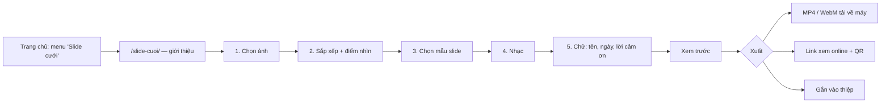

# Plan: Phân hệ "Slide cưới" (video trình chiếu ảnh cưới)

> Trạng thái: **P0 xong** (mục menu + trang `/slide-cuoi/` "Sắp ra mắt") — P1 trở đi chờ chốt
> các câu hỏi ở cuối file.

Khách chọn ảnh cưới → chọn mẫu slide + nhạc + chữ → xem trước → **xuất video** để đăng
mạng xã hội, gửi Zalo, chiếu màn LED ở tiệc cưới, hoặc gắn thẳng vào thiệp.

---

## 1. Định dạng xuất đề xuất

| #   | Định dạng                           | Dùng cho                                                  | Cách làm                                   | Giai đoạn |
| --- | ----------------------------------- | --------------------------------------------------------- | ------------------------------------------ | --------- |
| 1   | **MP4** (H.264 + AAC), 1080p 30fps  | Mọi nơi: Facebook, Zalo, TikTok, YouTube, USB cắm TV      | WebCodecs `VideoEncoder` + muxer MP4       | P1        |
| 2   | **WebM** (VP9 + Opus)               | Dự phòng khi máy không mã hoá được H.264 (Firefox/Linux…) | Cùng đường WebCodecs, đổi codec + muxer    | P1        |
| 3   | **Link xem online** `/slide/<mã>`   | Gửi link, quét QR ở bàn tiệc, NHÚNG làm một mục trong thiệp | Trình phát web dựng lại từ dự án (không tốn video) | P2  |
| 4   | **GIF / WebP động** (≤ 10s, 480px)  | Teaser gửi chat Zalo/Messenger, ảnh động story            | Lấy mẫu khung từ cùng engine + `gifenc`    | P3        |
| 5   | **Bộ ảnh JPG từng slide** (.zip)    | In ảnh, khung ảnh điện tử, đăng album                     | `canvas.toBlob` từng cảnh + nén zip        | P3        |
| 6   | **MP4 4K / 60fps**                  | Màn LED lớn ở hội trường                                  | Như (1), chỉ khi `isConfigSupported` cho phép | P3     |

**Ba khổ khung** cho (1)(2)(4): **9:16** (1080×1920 — Reels/TikTok/Zalo story, mặc định trên
điện thoại), **16:9** (1920×1080 — màn LED, TV, YouTube), **1:1** (1080×1080 — bảng tin Facebook).
Cùng một dự án xuất được cả ba: mẫu slide khai bố cục theo tỉ lệ, ảnh tự cắt theo
**điểm nhìn** (dùng lại `openFocalPointPicker()` ở `core/utils.js`).

Không đề xuất: **MOV/AVI** (không thêm gì so với MP4), **PowerPoint** (mất hiệu ứng/nhạc,
khách cần video chứ không cần file thuyết trình), **ffmpeg.wasm** (xem §3.3).

---

## 2. Luồng người dùng



1. **Chọn ảnh** — từ máy (nhiều ảnh, kéo thả) **hoặc lấy lại album của một thiệp đã tạo**
   (khách đã upload ảnh cưới rồi, đừng bắt chọn lại). Gợi ý 15–40 ảnh.
2. **Sắp xếp** — kéo đổi thứ tự, nút "Xếp theo ngày chụp" (EXIF), đặt điểm nhìn từng ảnh.
3. **Mẫu slide** — xem trước chạy thật trên khung `.cx-phone` (dùng lại khung điện thoại
   của trang Thiết lập).
4. **Nhạc** — thư viện nhạc miễn phí bản quyền tự host + tải mp3 từ máy; cắt đoạn bắt đầu,
   fade in/out; độ dài video tự khớp độ dài đoạn nhạc (hoặc ngược lại).
5. **Chữ** — tên cô dâu chú rể, ngày cưới, câu mở đầu/kết thúc (lấy sẵn từ thiệp nếu có).
6. **Xuất** — chọn khổ (9:16 · 16:9 · 1:1) + định dạng → thanh tiến độ → tải về / chia sẻ
   (`navigator.share` với file trên điện thoại).

---

## 3. Kiến trúc kỹ thuật

### 3.1 Một engine dựng hình duy nhất — `core/slide/`

Nguyên tắc giống thiệp ("bản xem thử đi chung đường với thiệp thật"): **xem trước, trình
phát online và bộ xuất video gọi CÙNG MỘT hàm** `renderFrame(ctx, project, t)` — vẽ khung tại
thời điểm `t` lên canvas, **thuần theo thời gian** (không dựa `requestAnimationFrame`, không
trạng thái ẩn). Nhờ vậy xuất video là lặp `t = 0, 1/30, 2/30…` chính xác từng khung, không
phụ thuộc máy nhanh hay chậm, và video ra y hệt bản xem trước.

```
core/slide/
  slide-model.js      Dự án → timeline (cảnh, thời lượng, chuyển cảnh); validate (BL)
  slide-engine.js     renderFrame(ctx, project, t) — Canvas 2D: Ken Burns, chuyển cảnh, chữ
  slide-assets.js     Nạp ảnh → ImageBitmap đã thu nhỏ về khổ xuất; nạp font (document.fonts.load)
  slide-audio.js      Giải mã nhạc, cắt + fade bằng OfflineAudioContext → PCM
  slide-export.js     Vòng lặp mã hoá: VideoEncoder/AudioEncoder → muxer → Blob
  slide-player.js     Trình phát web (rAF gọi renderFrame) — dùng cho xem trước + link online
public/slides/<tên-mẫu>/template.js   Bản khai mẫu slide (chỉ khai báo, như CX_THEME)
slide-cuoi/                            Trang giới thiệu + trình tạo (vỏ + bước)
```

**Mẫu slide là bản khai JSON-like**, không phải mã vẽ riêng: danh sách cảnh (1 ảnh / 2 ảnh
ghép / ảnh + chữ), chuyển cảnh (`fade`, `slide`, `zoom`, `wipe`, `blur`…), kiểu chữ (font tự
host ở `styles/_fonts.css`), màu đi qua bộ token như thiệp. Engine lặp bố cục của mẫu cho đủ
số ảnh. Đặt tên mẫu theo quy ước tên tiếng Việt như mẫu thiệp. Chuyển cảnh nằm DUY NHẤT trong
engine (thêm hiệu ứng mới = thêm một hàm ở đó), mẫu chỉ chọn tên.

Canvas 2D đủ cho P1 (Ken Burns + crossfade + chữ). Hiệu ứng nặng (blur động, lật trang 3D)
để P3, lúc đó mới cân nhắc WebGL — và chỉ trong engine, mẫu không đổi.

### 3.2 Xuất video ở TRÌNH DUYỆT (khuyến nghị cho P1)

- **WebCodecs** `VideoEncoder` (H.264 `avc1.640028`, ~8 Mbps cho 1080p) + `AudioEncoder`
  (AAC `mp4a.40.2`, 128 kbps), đóng gói bằng **Mediabunny** (thư viện muxer MP4/WebM thuần JS,
  kế nhiệm `mp4-muxer`/`webm-muxer`, ~nhỏ, không cần SharedArrayBuffer). Pin phiên bản + tự
  host trong `core/vendor/` (hoặc jsdelivr kèm `integrity`, CSP đã cho phép).
- Chọn codec bằng `VideoEncoder.isConfigSupported()`: H.264 → MP4; không được thì VP9 → WebM;
  không có WebCodecs (trình duyệt quá cũ) thì **dự phòng `MediaRecorder`** quay canvas theo
  thời gian thực (chậm bằng độ dài video, chất lượng kém hơn) — hoặc báo "Hãy mở bằng Chrome/
  Safari mới".
- Hỗ trợ: Chrome/Edge 94+, Safari 16.4+ (iOS 16.4+), Firefox 130+. Riêng `AudioEncoder` AAC
  trên Safari phải kiểm `isConfigSupported` lúc chạy — thiếu thì mã hoá tiếng bằng Opus hoặc
  ghép tiếng qua MediaRecorder; cần test thật trên iPhone trước khi chốt.
- **Bộ nhớ trên điện thoại** (iOS Safari giết tab quá ~1.5 GB): ảnh giải mã thành
  `ImageBitmap` ĐÃ thu về ≤ khổ xuất ngay khi nạp, giải phóng `VideoFrame.close()` từng khung,
  giới hạn hàng đợi encoder (`encodeQueueSize`) để không dồn khung.
- **Giữ màn sáng** bằng Wake Lock API trong lúc xuất; tab bị ẩn thì tạm dừng + báo (trình
  duyệt bóp nhịp tab nền). Video 3 phút 1080p trên máy tầm trung dự kiến 1–3 phút — cần đo.
- Lợi ích: **không tốn server, không lưu video** (một video 1080p 3 phút ≈ 150–200 MB, nhân
  số khách là chi phí Storage lớn), ảnh không phải rời máy khách nếu chưa đăng nhập.

### 3.3 Phương án đã cân nhắc và KHÔNG chọn cho P1

| Phương án                         | Vì sao không                                                                                                    |
| --------------------------------- | --------------------------------------------------------------------------------------------------------------- |
| **ffmpeg.wasm**                   | ~30 MB tải về, chậm 5–10× WebCodecs, cần `SharedArrayBuffer` → header COOP/COEP làm vỡ iframe YouTube/bản đồ.   |
| **Render ở server** (ffmpeg/Remotion trên VPS hoặc Lambda) | Edge Function Supabase không chạy được job dài/ffmpeg; phải dựng hạ tầng mới + hàng đợi + lưu video. Để dành P3 làm "xuất hộ" cho máy yếu nếu số liệu cho thấy cần. |
| **Quay màn hình bằng MediaRecorder làm đường chính** | Phụ thuộc tốc độ máy (giật = video giật), xuất mất đúng bằng thời lượng video, WebM trên Chrome. Chỉ làm dự phòng. |

### 3.4 Nhạc

- Thiệp đang phát nhạc qua **YouTube iframe** — **không dùng được cho video** (không lấy
  được luồng tiếng do CORS, và vi phạm điều khoản YouTube). Cần **thư viện nhạc tự host**
  (nhạc miễn phí bản quyền / mua license) ở `assets/music/` hoặc R2 + danh mục JSON.
- Khách tải mp3 của mình: được, kèm dòng nhắc bản quyền (Facebook/TikTok có thể tắt tiếng
  video dùng nhạc có bản quyền) — trách nhiệm thuộc khách, ghi vào `/policy/`.
- Trộn tiếng bằng `OfflineAudioContext` (cắt đoạn, fade, lặp nếu ngắn hơn video) → PCM →
  `AudioEncoder`. P3: dò nhịp (beat) để đặt mốc chuyển cảnh trùng phách.

### 3.5 Lưu dự án & dữ liệu (P2 — P1 chỉ lưu trên máy)

- **P1: nháp chỉ ở IndexedDB** — ảnh cất dạng BYTE qua `CXImagePick.toStored/fromStored`
  (đừng cất File/Blob — lỗi WebKit đã gặp ở trang Thiết lập). Không đụng DB, không changelog.
- **P2: lưu lên server khi đã đăng nhập** (để có link online + mở lại trên máy khác):
  - Bảng mới `slideshows` (`id`, `user_id`, `wedding_id` null được, `storage_key`, `slug`/mã
    chia sẻ, `project jsonb`, `status`, `created_at`, `updated_at`) — script **idempotent** ở
    `changelogs/RC<số lớn nhất>/schema/`, người dùng tự chạy trên CẢ HAI project. Không
    grant cho `anon`/`authenticated`.
  - Edge Function mới `slideshow-handler` (`withAxiom`, mọi nhánh lỗi gọi `log.*`, kiểm
    chủ sở hữu, giới hạn số dự án/tài khoản giống `wedding-limits.ts`). Thêm tên vào đúng
    danh sách `verify_jwt` ở `scripts/deploy-functions.sh`, deploy **cả hai** project, khai
    CORS như các function khác.
  - Ảnh: thư mục riêng `s/<storage_key>/` trong bucket `wedding-images` → phải khai luật
    đường dẫn này ở `_shared/wedding-images.ts` (+ bản sao ở image-proxy và
    `worker/index.js`), không thì tab "Dọn dữ liệu" coi ảnh slide là rác. Ảnh lấy từ thiệp thì
    **trỏ lại** đường dẫn cũ, không chép (nhưng xoá thiệp phải biết slide đang dùng ảnh đó —
    hoặc đơn giản hơn: chép sang thư mục slide lúc import).
  - Cron `cleanup-weddings` dọn dự án slide bỏ quên; số ngày khai ở `CONFIG.retention` **và**
    `RETENTION_DAYS` (xem `docs/cleanup-retention.md`).
- **Link xem online** `/slide/<mã>`: trang tĩnh chạy `slide-player.js`, đọc dự án qua Edge
  Function (worker cache được như `?slug=`), có thẻ og:* (ảnh bìa + tên đôi) do worker chèn —
  nhớ thêm vào `worker/route-html.mjs` + `scripts/dev-server.mjs` cùng lúc.
- **Gắn vào thiệp**: mục mới "Slide kỷ niệm" trong `base-theme` + helper dùng chung
  (`core/helpers/slide-section-helper.js`) nhúng trình phát — mẫu đã phát hành không phải
  sửa (theo quy ước "chức năng mới thêm vào mẫu nền + helper").

### 3.6 Bảo vệ & thương mại

- **Bản miễn phí**: xuất được, có **logo Cưới Xinh mờ ở góc** + màn kết thúc "Tạo slide tại
  cuoixinh.com" (kênh lan truyền), tối đa 720p.
- **Bỏ logo + 1080p/4K**: đề xuất **tặng kèm khi thiệp đã trả gói Premium/Forever** (không phải
  dựng luồng thanh toán mới cho P1). Bán lẻ riêng thì phải mở rộng `payment-handler` + `plans.ts`
  sang loại sản phẩm mới — để P2, và giá vẫn chỉ có MỘT nguồn ở server.
- Vì xuất chạy ở client, chặn logo ở client là chặn "người ngay" — chấp nhận được (giống
  `no-inspect.js`). Muốn chặn thật thì phải render server (P3).

---

## 4. Các giai đoạn

### P0 — Lối vào (ĐÃ LÀM)
- Mục **"Slide cưới"** cạnh "Bảng giá" ở navbar trang chủ + menu màn mở đầu trên điện thoại
  (`js/hero-menu.js`).
- Trang `/slide-cuoi/` giới thiệu + nhãn "Sắp ra mắt"; khai vào `INCLUDE` của
  `scripts/deploy-public.mjs` và `content` của `tailwind.config.js`.

### P1 — MVP chạy hoàn toàn ở trình duyệt
- Engine `core/slide/` (Canvas 2D) + 3 mẫu slide (một nhẹ nhàng, một điện ảnh, một vui tươi).
- Trình tạo 5 bước (dùng lại khung bước + `.cx-phone` của Thiết lập ở mức có thể), nháp
  IndexedDB.
- Nhạc: 10–15 bài tự host + tải mp3 từ máy.
- Xuất **MP4 1080p 9:16 + 16:9**, dự phòng WebM/MediaRecorder; logo mờ cho bản miễn phí.
- Kiểm thử thiết bị: iPhone (iOS 16.4/17/18), Android tầm trung, Chrome/Safari/Edge/Firefox
  desktop. **Đây là rủi ro lớn nhất — làm một bản thử nghiệm (spike) xuất 60s video trên
  iPhone thật TRƯỚC khi dựng giao diện.**

### P2 — Lưu & chia sẻ
- Bảng `slideshows` + Edge Function `slideshow-handler` (thứ tự: SQL → function → web,
  staging trước rồi production).
- Lấy ảnh từ thiệp đã tạo, link xem online `/slide/<mã>` + QR + og:*, khổ 1:1.
- Mục "Slide kỷ niệm" trong `base-theme`.
- XuXi (AI) gợi ý chữ mở đầu/kết thúc, chọn & xếp ảnh đẹp.

### P3 — Mở rộng
- GIF/WebP teaser, ZIP ảnh từng slide, 4K/60fps cho LED.
- Dò nhịp nhạc, hiệu ứng WebGL.
- Render server ("xuất hộ") cho máy không đủ sức — chỉ khi số liệu P1 cho thấy tỉ lệ lỗi
  xuất đáng kể.

---

## 5. Việc phải nhớ (ràng buộc của repo)

- Trang mới → `INCLUDE` (`scripts/deploy-public.mjs`) + `content` (`tailwind.config.js`) →
  `npm run build` và commit `styles/build.css`. Mọi trang nạp `no-zoom.js`, `no-inspect.js`,
  `x-button.js`, lucide (pin + `integrity`).
- Thư viện ngoài (Mediabunny, gifenc, zip) — pin phiên bản; nếu nạp từ CDN thì miền phải nằm
  trong `script-src` của `_headers` (jsdelivr/unpkg/cdnjs đã có). Video xem trước dùng
  `blob:` — `media-src` đã cho phép.
- **Trùng slug:** `/slide-cuoi/` (và `/slide/` ở P2) là thư mục tĩnh nên **che mất** thiệp
  nào có slug trùng tên. Hiện chưa có danh sách slug cấm — nên thêm một danh sách "tên đã
  dành" ở `SLUG_RE` phía server (`wedding-admin`) + bản client `core/bl/wedding-bl.js`, gồm
  mọi thư mục ở gốc (kiểm trên production xem đã có thiệp nào dùng `slide-cuoi`/`slide` chưa).
- Deploy là đổi `CX_VERSION`. Ra mắt thật thì thêm `/slide-cuoi/` vào `sitemap.xml`.
- Edge Function: log Axiom ở mọi nhánh lỗi, `error` của mọi truy vấn kiểm ngay, deploy cả
  hai project.

---

## 6. Câu hỏi cần chốt trước P1

1. **Mô hình thu phí**: tặng kèm thiệp Premium/Forever (đề xuất, làm nhanh) hay bán riêng?
2. **Nguồn nhạc**: mua gói nhạc license (Artlist/Epidemic…) hay chỉ dùng nhạc miễn phí bản
   quyền (Pixabay/YouTube Audio Library — phải đọc kỹ điều khoản phân phối lại)?
3. **Bắt buộc gắn với một thiệp** hay cho tạo slide độc lập (khách chỉ cần video, không cần
   thiệp)? Đề xuất: độc lập, có nút "lấy ảnh từ thiệp".
4. Tên đường dẫn: giữ `/slide-cuoi/` hay đổi (`/video-cuoi/`…) — đổi sau khi đã có link
   ngoài là gãy link, nên chốt sớm.
