# Plan: Phân hệ "Slide cưới" (video trình chiếu ảnh cưới)

> Trạng thái: **P0 xong** (mục menu + trang `/slide-cuoi/` "Sắp ra mắt") — P1 trở đi chờ chốt
> các câu hỏi ở cuối file.

**Mục đích: công cụ MIỄN PHÍ để kéo người truy cập vào trang**, KHÔNG gắn với thiệp cưới.
Khách chọn ảnh → chọn mẫu slide + nhạc + chữ → xem trước → **xuất video** để đăng mạng xã
hội, gửi Zalo, chiếu màn LED ở tiệc cưới. Không cần đăng nhập, không trả tiền.

Hệ quả thiết kế — giữ cho phân hệ này **chạy trọn ở trình duyệt**:

- Không bảng DB, không Edge Function, không changelog, không upload ảnh lên Storage → không
  tốn chi phí theo số người dùng, không có dữ liệu cá nhân của khách nằm trên server.
- Không đụng tới luồng thiệp: không lấy ảnh từ thiệp, không gắn vào thiệp, không thanh toán,
  không đọc `CXAuth` (đăng nhập hay chưa đều dùng như nhau).
- Giá trị thu về là **lượt truy cập**: trang dễ lên Google, và sau khi xuất xong có lời mời
  sang làm thiệp. Video xuất ra **sạch** — không màn kết, không logo (đã chốt).

---

## 1. Định dạng xuất đề xuất

| #   | Định dạng                          | Dùng cho                                                  | Cách làm                                      | Giai đoạn |
| --- | ---------------------------------- | --------------------------------------------------------- | --------------------------------------------- | --------- |
| 1   | **MP4** (H.264 + AAC), 1080p 30fps | Mọi nơi: Facebook, Zalo, TikTok, YouTube, USB cắm TV      | WebCodecs `VideoEncoder` + muxer MP4          | P1        |
| 2   | **WebM** (VP9 + Opus)              | Dự phòng khi máy không mã hoá được H.264 (Firefox/Linux…) | Cùng đường WebCodecs, đổi codec + muxer       | P1        |
| 3   | **GIF / WebP động** (≤ 10s, 480px) | Teaser gửi chat Zalo/Messenger, ảnh động story            | Lấy mẫu khung từ cùng engine + `gifenc`       | P2        |
| 4   | **Bộ ảnh JPG từng slide** (.zip)   | In ảnh, khung ảnh điện tử, đăng album                     | `canvas.toBlob` từng cảnh + nén zip           | P2        |
| 5   | **MP4 4K / 60fps**                 | Màn LED lớn ở hội trường                                  | Như (1), chỉ khi `isConfigSupported` cho phép | P2        |

**Ba khổ khung** cho (1)(2)(3): **9:16** (1080×1920 — Reels/TikTok/Zalo story, mặc định trên
điện thoại), **16:9** (1920×1080 — màn LED, TV, YouTube), **1:1** (1080×1080 — bảng tin
Facebook). Cùng một dự án xuất được cả ba: mẫu slide khai bố cục theo tỉ lệ, ảnh tự cắt theo
**điểm nhìn** (dùng lại `openFocalPointPicker()` ở `core/utils.js`).

Trên điện thoại, xuất xong có nút **Chia sẻ** (`navigator.share` kèm file) để đẩy thẳng sang
Zalo/Facebook/TikTok, khỏi phải tìm file trong máy.

Không đề xuất: **link xem online** (phải lưu ảnh khách lên server → tốn kho + dữ liệu cá nhân,
trái mục đích công cụ miễn phí), **MOV/AVI** (không thêm gì so với MP4), **PowerPoint** (mất
hiệu ứng/nhạc), **ffmpeg.wasm** (xem §3.3).

---

## 2. Luồng người dùng

```mermaid
flowchart LR
  A[Trang chủ: menu 'Slide cưới'] --> B["/slide-cuoi/ — giới thiệu + trình tạo"]
  B --> C[1. Chọn ảnh]
  C --> D[2. Sắp xếp + điểm nhìn]
  D --> E[3. Chọn mẫu slide]
  E --> F[4. Nhạc]
  F --> G[5. Chữ: tên, ngày, lời cảm ơn]
  G --> H[Xem trước]
  H --> I[Xuất MP4 / WebM]
  I --> J[Tải về · Chia sẻ]
  J --> K[Lời mời: xem mẫu thiệp]
```



1. **Chọn ảnh** — từ máy (nhiều ảnh, kéo thả). Gợi ý 15–40 ảnh. Ảnh **không rời máy khách**
   — nói rõ điều này trên trang, đó là một điểm cộng để khách yên tâm.
2. **Sắp xếp** — kéo đổi thứ tự, nút "Xếp theo ngày chụp" (EXIF), đặt điểm nhìn từng ảnh.
3. **Mẫu slide** — xem trước chạy thật trong khung điện thoại.
4. **Nhạc** — thư viện nhạc miễn phí bản quyền tự host + tải mp3 từ máy; cắt đoạn bắt đầu,
   fade in/out; độ dài video tự khớp độ dài đoạn nhạc (hoặc ngược lại).
5. **Chữ** — tên cô dâu chú rể, ngày cưới, câu mở đầu/kết thúc (khách tự gõ).
6. **Xuất** — chọn khổ + định dạng → thanh tiến độ → tải về / chia sẻ → khối mời làm thiệp.

Trang `/slide-cuoi/` vừa là trang giới thiệu (cho SEO: "làm video slide ảnh cưới miễn phí")
vừa chứa trình tạo — khách vào là dùng được ngay, không qua thêm trang nào.

---

## 3. Kiến trúc kỹ thuật

### 3.1 Một engine dựng hình duy nhất

Xem trước và bộ xuất video gọi **CÙNG MỘT hàm** `renderFrame(ctx, project, t)` — vẽ khung tại
thời điểm `t` lên canvas, **thuần theo thời gian** (không dựa `requestAnimationFrame`, không
trạng thái ẩn). Nhờ vậy xuất video là lặp `t = 0, 1/30, 2/30…` chính xác từng khung, không phụ
thuộc máy nhanh hay chậm, và video ra y hệt bản xem trước.

```
slide-cuoi/
  index.html            Trang giới thiệu + trình tạo
  js/slide-model.js     Dự án → timeline (cảnh, thời lượng, chuyển cảnh); validate
  js/slide-engine.js    renderFrame(ctx, project, t) — Canvas 2D: Ken Burns, chuyển cảnh, chữ
  js/slide-assets.js    Ảnh → ImageBitmap đã thu nhỏ về khổ xuất; nạp font (document.fonts.load)
  js/slide-audio.js     Giải mã nhạc, cắt + fade bằng OfflineAudioContext → PCM
  js/slide-export.js    Vòng lặp mã hoá: VideoEncoder/AudioEncoder → muxer → Blob
  js/slide-player.js    Phát xem trước (rAF gọi renderFrame)
  js/slide-ui.js        Các bước, kéo thả, thanh tiến độ
  templates/<tên>.js    Bản khai mẫu slide (chỉ khai báo)
```

Để trọn trong `slide-cuoi/` (không rải vào `core/`) vì không trang nào khác dùng — đúng tinh
thần "không gắn với thiệp". Thư mục đã khai ở `INCLUDE` nên file mới bên trong tự ra web.

**Mẫu slide là bản khai**, không phải mã vẽ riêng: danh sách cảnh (1 ảnh / 2 ảnh ghép / ảnh +
chữ), chuyển cảnh (`fade`, `slide`, `zoom`, `wipe`…), kiểu chữ (font tự host ở
`styles/_fonts.css`), bảng màu. Engine lặp bố cục của mẫu cho đủ số ảnh. Chuyển cảnh nằm DUY
NHẤT trong engine (thêm hiệu ứng mới = thêm một hàm ở đó), mẫu chỉ chọn tên. Canvas 2D đủ cho
P1; hiệu ứng nặng (blur động, lật trang 3D) để sau, lúc đó mới cân nhắc WebGL.

### 3.2 Xuất video ở trình duyệt

- **WebCodecs** `VideoEncoder` (H.264 `avc1.640028`, ~8 Mbps cho 1080p) + `AudioEncoder`
  (AAC `mp4a.40.2`, 128 kbps), đóng gói bằng **Mediabunny** (muxer MP4/WebM thuần JS, kế nhiệm
  `mp4-muxer`/`webm-muxer`, không cần SharedArrayBuffer). Pin phiên bản, nạp từ jsdelivr kèm
  `integrity` (CSP đã cho phép miền này) hoặc tự host trong `slide-cuoi/vendor/`.
- Chọn codec bằng `VideoEncoder.isConfigSupported()`: H.264 → MP4; không được thì VP9 → WebM;
  không có WebCodecs (trình duyệt quá cũ) thì **dự phòng `MediaRecorder`** quay canvas theo
  thời gian thực (chậm bằng độ dài video) — hoặc báo "Hãy mở bằng Chrome/Safari mới".
- Hỗ trợ: Chrome/Edge 94+, Safari 16.4+ (iOS 16.4+), Firefox 130+. `AudioEncoder` AAC trên
  Safari phải kiểm `isConfigSupported` lúc chạy — thiếu thì mã hoá tiếng bằng Opus hoặc ghép
  tiếng qua MediaRecorder; cần test thật trên iPhone trước khi chốt.
- **Bộ nhớ trên điện thoại** (iOS Safari giết tab quá ~1.5 GB): ảnh giải mã thành
  `ImageBitmap` ĐÃ thu về ≤ khổ xuất ngay khi nạp, `VideoFrame.close()` từng khung, giới hạn
  hàng đợi encoder (`encodeQueueSize`) để không dồn khung.
- **Giữ màn sáng** bằng Wake Lock API trong lúc xuất; tab bị ẩn thì tạm dừng + báo. Video 3
  phút 1080p trên máy tầm trung dự kiến 1–3 phút — cần đo.

### 3.3 Phương án đã cân nhắc và KHÔNG chọn

| Phương án                                            | Vì sao không                                                                                                  |
| ---------------------------------------------------- | ------------------------------------------------------------------------------------------------------------- |
| **ffmpeg.wasm**                                      | ~30 MB tải về, chậm 5–10× WebCodecs, cần `SharedArrayBuffer` → header COOP/COEP làm vỡ iframe YouTube/bản đồ. |
| **Render ở server** (ffmpeg/Remotion)                | Tốn chi phí theo từng lượt dùng — vô lý với một công cụ miễn phí; Edge Function cũng không chạy nổi job dài.   |
| **Quay màn hình bằng MediaRecorder làm đường chính** | Phụ thuộc tốc độ máy (máy giật = video giật), mất đúng bằng thời lượng video. Chỉ làm dự phòng.               |

### 3.4 Nhạc

- Thiệp đang phát nhạc qua **YouTube iframe** — **không dùng được cho video** (không lấy được
  luồng tiếng do CORS, và vi phạm điều khoản YouTube). Cần **thư viện nhạc tự host** (chỉ nhạc
  miễn phí bản quyền, được phép phân phối lại — đọc kỹ điều khoản từng nguồn) ở
  `assets/music/` + danh mục JSON.
- Khách tải mp3 của mình: được, kèm dòng nhắc bản quyền (Facebook/TikTok có thể tắt tiếng
  video dùng nhạc có bản quyền) — trách nhiệm thuộc khách, ghi vào `/policy/`.
- Trộn tiếng bằng `OfflineAudioContext` (cắt đoạn, fade, lặp nếu ngắn hơn video) → PCM →
  `AudioEncoder`.

### 3.5 Lưu nháp

Nháp chỉ ở **IndexedDB** trên máy — ảnh cất dạng BYTE qua `CXImagePick.toStored/fromStored`
(đừng cất File/Blob: lỗi WebKit đã gặp ở trang Thiết lập). Mở lại trang là thấy dự án dở.
Không có bản trên server, nên không có "mở trên máy khác" — chấp nhận được với công cụ này.

### 3.6 Kéo khách về Cưới Xinh

- **Video không có màn kết, không logo** (đã chốt) — công cụ phải dễ chịu thì khách mới
  quay lại và giới thiệu cho nhau.
- **Sau khi xuất xong** hiện khối mời: "Làm luôn thiệp cưới online — xem mẫu" → `/theme-template/`.
- **SEO**: tiêu đề/mô tả nhắm "làm video slide ảnh cưới miễn phí", thêm vào `sitemap.xml` khi
  ra mắt, thẻ og:* để link gửi Zalo/Facebook có ảnh.
- Đo hiệu quả: Cloudflare Web Analytics đã có sẵn (lượt xem trang). Muốn đếm số video xuất thì
  để sau — cần một endpoint đếm, tức là thêm tầng server.

---

## 4. Các giai đoạn

### P0 — Lối vào (ĐÃ LÀM)
- Mục **"Slide cưới"** cạnh "Bảng giá" ở navbar trang chủ + menu màn mở đầu trên điện thoại
  (`js/hero-menu.js`).
- Trang `/slide-cuoi/` giới thiệu + nhãn "Sắp ra mắt"; khai vào `INCLUDE` của
  `scripts/deploy-public.mjs` và `content` của `tailwind.config.js`.

### P1 — MVP
- **Làm thử trước (spike):** xuất 60s video MP4 có nhạc trên iPhone thật + Android tầm trung.
  Đây là rủi ro lớn nhất — qua được mới dựng giao diện.
- Engine Canvas 2D + 3 mẫu slide (một nhẹ nhàng, một điện ảnh, một vui tươi).
- Trình tạo 5 bước ngay trên `/slide-cuoi/`, nháp IndexedDB.
- Nhạc: 10–15 bài tự host + tải mp3 từ máy.
- Xuất **MP4 1080p 9:16 + 16:9 + 1:1**, dự phòng WebM/MediaRecorder; nút chia sẻ; khối mời xem
  mẫu thiệp.
- Kiểm thử: iPhone (iOS 16.4/17/18), Android tầm trung, Chrome/Safari/Edge/Firefox desktop.
- Thêm vào `sitemap.xml`, bỏ nhãn "Sắp ra mắt".

### P2 — Mở rộng
- GIF/WebP teaser, ZIP ảnh từng slide, 4K/60fps cho LED.
- Thêm mẫu slide; dò nhịp nhạc để chuyển cảnh trùng phách; hiệu ứng WebGL.

---

## 5. Việc phải nhớ (ràng buộc của repo)

- Class Tailwind mới trong `slide-cuoi/` → `npm run build` và commit `styles/build.css`
  (thư mục đã có trong `content`). Trang nạp `no-zoom.js`, `no-inspect.js`, `x-button.js`,
  lucide (pin + `integrity`) — đã có sẵn.
- Thư viện ngoài (Mediabunny, gifenc, zip) — pin phiên bản + `integrity` (LINT-24 gác).
- **Trùng slug:** `/slide-cuoi/` là thư mục tĩnh nên **che mất** thiệp nào có slug trùng tên.
  Hiện chưa có danh sách slug cấm — nên thêm danh sách "tên đã dành" ở luật slug phía server
  (`wedding-admin`) + bản client `core/bl/wedding-bl.js`, gồm mọi thư mục ở gốc (kiểm trên
  production xem đã có thiệp nào dùng `slide-cuoi` chưa).
- Deploy là đổi `CX_VERSION`.

---

## 6. Câu hỏi cần chốt trước P1

Đã chốt: **không màn kết/logo** · **giữ đường dẫn `/slide-cuoi/`** · nhạc chọn từ **YouTube**.

Còn mở — cách đưa nhạc YouTube vào video: trình duyệt KHÔNG lấy được luồng tiếng của
YouTube (iframe khác miền, và điều khoản YouTube cấm tải/tách tiếng), nên chỉ PHÁT được khi
xem trước chứ không GHI được vào file. Đề xuất: chọn bài YouTube để nghe lúc xem trước (dùng
lại ô tìm YouTube của trang Thiết lập), video xuất ra không tiếng — khách gắn nhạc trên
TikTok/Facebook/CapCut (thư viện nhạc có bản quyền của nền tảng, không bị tắt tiếng) — cộng
tuỳ chọn tải mp3 từ máy để video có sẵn tiếng.
